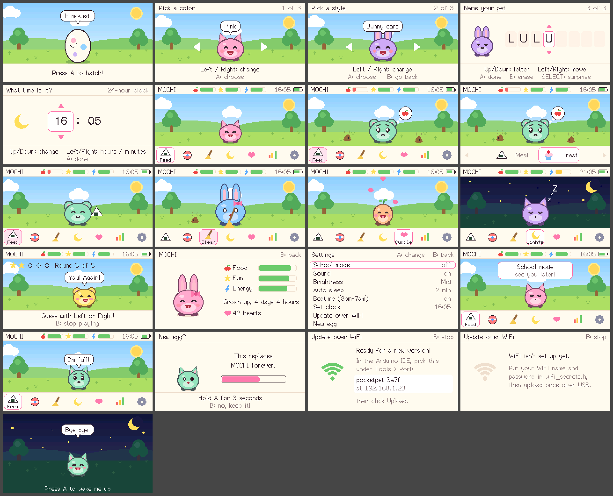
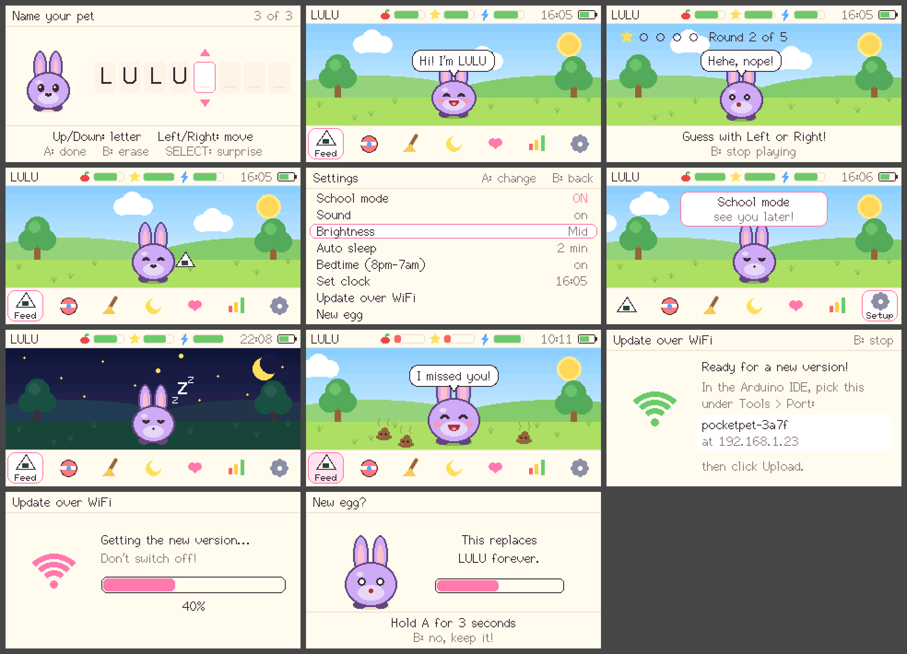

# PocketPet

A gentle virtual pet for kids, on a homemade Game Boy-style handheld: a
D-pad, A and B, Start and Select, and a wide color screen.

The pet **never dies**. If nobody looks after it, it gets hungry, bored or
sleepy and asks for help. As soon as someone feeds it or plays with it, it
cheers up again.

## Play it in a browser

`docs/play.html` is the same game, compiled for the web. Open it in any
browser on a computer, tablet or phone: no install, no handheld needed. Use
the arrow keys for the D-pad, **X** for A, **Z** for B, **Enter** for Start
and **Shift** for Select, or click the buttons on screen. The pet is saved in
that browser.

To rebuild it after changing the code, run
`tools/web/build.sh <path to a LovyanGFX checkout>` (it needs Zig:
`pip install ziglang`, then `ZIG="python3 -m ziglang"`).

## The handheld

PocketPet runs on the [EspBoy](https://github.com/paixonite/EspBoy)
design: a LILYGO T-Display S3 board with eight buttons, a buzzer, a
rechargeable battery and a 3D-printed case.

### Parts (per handheld)

| Part | About |
|---|---|
| LILYGO **T-Display S3** (the plain one, not AMOLED or touch, with pin headers) | $18–22 |
| 8 × 12 mm tactile push buttons | $2 |
| 8 × 10 kΩ resistors | $0.50 |
| Passive buzzer (not "active") | $0.50 |
| Small slide switch | $0.50 |
| TP4056 USB-C charging module | $1–2 |
| 3.7 V LiPo battery, flat; measure the inside of your printed case first | $6–10 |
| EspBoy circuit board (5 boards from JLCPCB or similar, so one order covers both kids) | $5–15 for 5, plus shipping |
| 4 × M2 × 16 mm screws and 4 × M2 nuts | $2 |
| About 50 g of PLA for the case | about $1 |

That comes to roughly **$35–45 each**. The two handhelds can share the
circuit-board order.

### Buying in Canada

Digi-Key.ca has some of these parts. The T-Display S3 and the TP4056 module
aren't sold there.

| Part | Where | Part number |
|---|---|---|
| 12 × 12 mm buttons (8, plus spares) | Digi-Key | Omron/Aratas **B3F-4055**, Digi-Key **SW414-ND** |
| Round caps for them (optional) | Digi-Key | Omron **B32** series, e.g. B32-1380 |
| 10 kΩ ¼ W resistors (8) | Digi-Key | e.g. Stackpole CF14JT10K0 |
| LiPo battery, 1200 mAh, 62 × 34 × 5 mm (check it fits your case) | Digi-Key | Adafruit **258**, Digi-Key **1528-1838-ND** |
| T-Display S3, plain LCD, no touch, soldered pins | [LILYGO store](https://lilygo.cc/en-us/products/t-display-s3) or Amazon.ca | |
| TP4056 USB-C charging module (the common blue board) | Amazon.ca | |
| Circuit boards | JLCPCB, from EspBoy's Gerber zip | |
| Buzzer and slide switch in EspBoy's exact sizes | LCSC, added to the JLCPCB order | buzzer **C49246969**, switch **C22435641** |
| M2 × 16 mm screws and M2 nuts | hardware store | |

Check live prices and stock before ordering; these part numbers came from
Digi-Key's listings in October 2026.

### Building it

1. **Board:** order the circuit board from the Gerber file in EspBoy's
   [`pcb/gerbers`](https://github.com/paixonite/EspBoy/tree/main/pcb/gerbers)
   folder. Upload the zip to JLCPCB (or similar) and keep the default
   options.
2. **Solder:** follow EspBoy's
   [schematic](https://github.com/paixonite/EspBoy/blob/main/pcb/EspBoy_Schematic.png).
   The buttons, resistors, buzzer and switch go on the board, then the
   T-Display S3, then the charger module and battery. Watch the battery's
   red (+) and black (−) wires.
3. **Case:** print `front_cover.stl` and `back_cover.stl` from EspBoy's
   [`case/stl`](https://github.com/paixonite/EspBoy/tree/main/case/stl)
   folder: PLA, 0.2 mm layers, 15–20 % infill, no supports, flat side down.
   Put the nuts in the back cover, drop the board in, and screw it shut.

## Putting PocketPet on it (one time, about 15 minutes)

1. Install the **Arduino IDE**: <https://www.arduino.cc/en/software>.
2. **Tools → Board → Boards Manager**: search for **esp32** (by Espressif
   Systems) and install it.
3. **Tools → Manage Libraries**: search for **LovyanGFX** and install it.
4. Download this project (the green **Code** button on GitHub, then
   **Download ZIP**) and unzip it.
5. **File → Open** `PocketPet/PocketPet.ino`.
6. Plug the handheld in with a USB-C cable to the **T-Display's own USB
   port**. Choose **Tools → Board → esp32 → LilyGo T-Display-S3**, then pick
   its port under **Tools → Port**.
7. Click **Upload** (→). When it says "Done uploading", the egg appears.

> If the upload can't find the board, hold the T-Display's **BOOT** button
> while plugging it in, then try again. If the picture is upside down, change
> `SCREEN_ROTATION` in `PocketPet/hardware.cpp` from 1 to 3.

## Updating the game later, over WiFi

In EspBoy's case, the outside USB-C port only charges the battery; the port
that updates the game is inside. So after the first upload, update over WiFi
instead of opening the case:

1. **Once, before the first USB upload:** copy `PocketPet/wifi_secrets.example.h`
   to `PocketPet/wifi_secrets.h` and fill in your WiFi name and password, and
   pick an update password. (`wifi_secrets.h` never goes to GitHub.)
2. **Each update:** on the handheld press **START → Update over WiFi**. It
   joins your WiFi and shows a name like `pocketpet-3a7f`.
3. In the Arduino IDE, pick that name under **Tools → Port**, click
   **Upload**, and type the update password when asked. The handheld shows a
   progress bar, saves the pet, and restarts with the new version.

The computer and the handheld must be on the same WiFi. The handheld stays
on for 10 minutes while waiting, and B cancels. If a WiFi upload fails
saying there's no room, set **Tools → Partition Scheme** to one with two app
slots (its name mentions "OTA" or "3MB APP"), then upload once more over USB.

## How to play

| Button | What it does |
|---|---|
| **D-pad** | move around: Left/Right along the bottom bar, Up/Down in lists |
| **A** | do it / choose |
| **B** | go back |
| **START** | settings |
| **SELECT** | sleep (switch off). Press **A** to wake it up. |

**First time:** press A three times to hatch the egg. Then pick a color, pick
ears (cat, bunny, bear or a little sprout), type a name the arcade way
(Up/Down picks a letter, Right moves on, SELECT picks a surprise name), and
set the clock.

**Every day:** Left/Right along the bottom bar, then A:

- **Feed**: a *Meal* fills the tummy; a *Treat* is a little food and a lot of
  fun. It says "I'm full!" if it isn't hungry.
- **Play**: the "Which way?" game. Guess which way the pet will look by
  pressing Left or Right. Five rounds.
- **Clean**: sweeps up poop. Poop makes the pet a bit sad until it's gone.
- **Lights**: puts it to bed, or wakes it up.
- **Cuddle**: hearts!
- **Stats**: food, fun and energy, its age, and how many hearts it has
  collected.
- **Setup**: the same as START.

When the pet needs something, a thought bubble appears: an apple (hungry), a
ball (bored), a moon (sleepy) or a broom (messy). That action also gets a
pink dot on the bar, and every so often the pet plays a little tune.

It grows from **baby** to **kid** after one day, and to **grown-up** (with a
bow) after three days.

## Settings (for grown-ups)

Press START. Up/Down picks a line; A (or Left/Right) changes it; B goes back.

| Setting | What it does |
|---|---|
| **School mode** | Freezes the pet completely, even while asleep. Turn it on before school and off after. |
| **Sound** | Turns the beeps on or off. |
| **Brightness** | Low, mid or high. Lower lasts longer on battery. |
| **Auto sleep** | Goes to sleep after 1, 2 or 5 minutes without a button press. The screen dims after 20 seconds. |
| **Bedtime** | On (the default): the pet falls asleep by itself at 8 pm and wakes at 7 am. If the kids wake it at night, it stays up a couple of minutes, then goes back to sleep. |
| **Set clock** | 24-hour time. |
| **Update over WiFi** | Gets a new version of the game from the Arduino IDE (see above). |
| **New egg** | Starts over. You have to hold A for 3 seconds so it can't happen by accident. |

## Sleeping vs. the power switch

- **SELECT** (or auto sleep) puts the handheld into a deep sleep. It uses
  very little battery (a charge should last days to weeks, depending on
  the battery), and the clock keeps running. Press A to wake it.
- The **slide switch** cuts the power completely. The pet is saved and comes
  back fine, but the clock forgets the time. Until you set it again (START →
  Set clock), time spent switched off isn't counted and there's no bedtime.
  Use the switch only for long storage.

## How "never dies" works

- **Needs go down slowly.** A full tummy lasts about 10 hours, and fun about
  8 hours.
- **Running out of energy just means a nap.**
- **While asleep, time still passes**, but needs drop at half speed and never
  below 20%. After a weekend away it's hungry and pleased to see you, never
  miserable.
- **Saving is automatic.** The pet is saved every 30 seconds and when it goes
  to sleep, so a flat battery doesn't lose it.

All of these numbers are in `PocketPet/config.h`. For example, raise
`OFFLINE_FLOOR` to make it even gentler, or change `BEDTIME_HOUR`.

## For tinkerers

- `PocketPet/pet.cpp`: the rules (no hardware code).
- `PocketPet/ui.cpp`: all the drawing. The pet and the meadow are drawn from
  shapes, not pictures, so colors and ears are easy to add.
- `PocketPet/PocketPet.ino`: controls, sound, clock and saving.
- `PocketPet/hardware.cpp`: pins, screen, buzzer, battery and sleep for the
  T-Display S3. To use different hardware, rewrite this file.
- `tools/web/`: the browser version (`web_main.cpp` stands in for the
  handheld's hardware; `play.html` is the page around it).
- `tools/host/`: checks that run on a computer, without the handheld:
  - `make -C tools/host test` checks the rules.
  - `make -C tools/host screenshots LGFX=<path to a LovyanGFX checkout>`
    draws every screen.
  - `make -C tools/host sim LGFX=<path to a LovyanGFX checkout>` runs the
    real `PocketPet.ino` through a pretend play session with fake buttons
    and clock.

Thanks to [EspBoy](https://github.com/paixonite/EspBoy) for the handheld and
[TamaFi](https://github.com/cifertech/TamaFi), where PocketPet started; see
[THIRD_PARTY_NOTICES.md](THIRD_PARTY_NOTICES.md).
